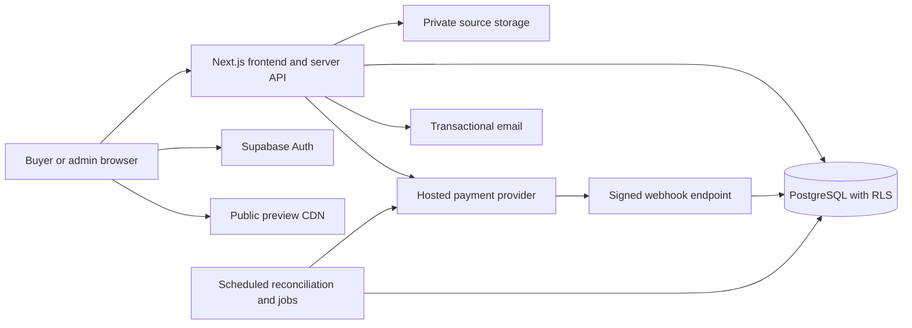

# RenderMarket: Software Architecture Document

Version 0.2 | 22 November 2026 | Proposed architecture, not an implemented system
Companion: technical-requirements.md

## 1. Architecture decisions
Use a modular monolith: Next.js with TypeScript for server-rendered pages and server-only domain services. Supabase provides PostgreSQL, authentication and initially private object storage. Paystack hosted checkout is proposed, pending merchant approval. A managed server-capable host replaces GitHub Pages for production; the current prototype can remain separately labelled. Avoid microservices until operational needs justify them.

## 2. Boundaries and modules
Catalogue owns publication and discovery. Identity owns session checks and profiles. Commerce owns orders, payment attempts and immutable snapshots. Fulfilment owns entitlement and download grants. Administration owns uploads and audit events. Shared validation and error handling remain small libraries. Every write goes through a server command; RLS is a second boundary, not a substitute for server checks. Privileged service credentials are server-only and used narrowly. Authenticated data access uses the caller's identity where possible.

## 3. Relational model
| Table | Essential columns and constraints |
|---|---|
| profiles | user_id PK/FK auth.users, display_name, created_at; no self-editable role |
| user_roles | user_id, role; unique pair; privileged writes only |
| assets | id, slug UNIQUE, title, description, creator_id, category_id, publication_status, current_version_id, price_minor CHECK >=0, currency |
| asset_versions | id, asset_id FK, version, status, published_at; UNIQUE(asset_id,version) |
| asset_files | id, version_id FK, format, private_object_key, sha256, byte_size, scan_status; no public key exposure |
| asset_previews | id, version_id, public_object_key, media_type, dimensions, preview_limits |
| categories | id, slug UNIQUE, name |
| licence_versions | id, code, version, immutable_text, created_at; UNIQUE(code,version) |
| saved_assets | user_id, asset_id; composite PK |
| orders | id, user_id, status, total_minor, currency, created_at |
| order_items | id, order_id, asset_id, asset_version_id, price_minor, licence_version_id, title_snapshot; immutable after checkout |
| payment_attempts | id, order_id, reference UNIQUE, provider_transaction_id UNIQUE nullable, status, amount_minor, currency, mode |
| payment_events | id, provider_event_key UNIQUE, payload_hash, processing_status, received_at; minimal retained payload |
| entitlements | id, user_id, order_item_id UNIQUE, asset_version_id, status, granted_at, revoked_at |
| download_grants | id, entitlement_id, file_id, issued_at, expires_at; never persist signed URL |
| refunds | id, payment_attempt_id, provider_reference UNIQUE, amount_minor, status |
| audit_events | id, actor_id nullable, action, target_type, target_id, redacted_metadata, created_at; append-only |
| outbox_jobs | id, kind, dedupe_key UNIQUE, payload, attempts, next_attempt_at, status |

Indexes: published catalogue/category, orders(user_id,created_at), entitlements(user_id,status), payment attempts(reference), jobs(status,next_attempt_at). Use foreign keys and transactional migrations. Account deletion must anonymize eligible profile fields while preserving required order evidence under the approved retention policy. Paid order history must not cascade-delete accidentally.

## 4. Access-control matrix
Public: select published asset metadata, approved previews and public licence text only. Buyer: own profile/saves/orders/items/entitlements; no writes to payment/entitlement status. Admin: server-verified permissions for catalogue and support actions. Private file metadata and storage: no anonymous or general authenticated listing/read policy. Only download service grants eligible source access. Test RLS using real anon and two distinct buyer identities. Preview GLBs are public inspectable geometry; they cannot be treated as confidential or copy-proof.

## 5. HTTP interfaces
GET /api/assets?query=&category=&sort=&cursor= returns bounded published results, with stable cursor pagination (id tie-breaker). GET /api/assets/:slug returns public listing data. PUT/DELETE /api/saved/:assetId requires buyer. POST /api/checkout takes asset/version/licence IDs and idempotency key, never an authoritative price. GET /api/orders/:id requires owner/admin. POST /api/downloads takes fileId and requires eligible entitlement. POST /api/webhooks/paystack validates raw-body signature. POST /api/admin/uploads grants scoped resumable upload access. POST /api/admin/assets/:id/publish validates all publication gates. Mutations enforce schemas, CSRF/origin where applicable and rate limits. Consistent errors: code, safe message, requestId; never stack traces or private object paths.

## 6. Payment and fulfilment sequence
1. Lock or consistently read current published asset price and approved version/licence. Create pending order/items and unique payment reference server-side; persist before calling provider.
2. Initialize hosted checkout using stored integer amount/currency. Retry with a new attempt only after resolving ambiguous initialization; idempotency maps repeated client requests to one order.
3. Browser return page displays pending and polls the owner's order; it cannot mark payment successful.
4. Authenticate webhook using provider-documented raw-payload signature and timing-safe comparison. Persist event durably before acknowledging; fail retryably if persistence fails.
5. Worker verifies transaction with provider and compares reference, provider ID, status, amount, currency, mode and stored order. Never fulfil on signature alone or client redirect.
6. In one database transaction, lock attempt/order, mark payment confirmed, create each entitlement with unique order_item_id and enqueue receipt. Duplicate delivery becomes a no-op.
7. Scheduled reconciliation resolves pending attempts and retries interrupted processing with bounded exponential backoff and alerts. Late success remains reconcilable even after UI timeout. Preserve distinct cancelled UI state and actual provider outcome.

State machines: payment initialized -> pending -> succeeded/failed; ambiguous provider outcomes remain pending until reconciled. Order pending -> paid -> fulfilled; refund_pending -> refunded or refund_failed; dispute recorded separately. Prevent a stale failure event from downgrading confirmed success. MVP supports full-order refunds only; partial refunds deferred. Revocation happens on confirmed refund, with dispute restrictions following the approved support policy.

## 7. Protected file delivery
Admin uploads to quarantine/private storage using random immutable keys. Check extension, MIME/signature, size, archive traversal/decompression limits, malware status and checksum. Human admin confirms rights and suitability before publication. Export conversion happens offline initially, not inside request handlers. A buyer download request checks current session, entitlement status and exact included file/version, then logs a grant and returns a signed URL expiring after 60 seconds. Rate limits prevent abuse without breaking legitimate format downloads. New asset versions do not silently change purchased rights: MVP pins purchases to the purchased version; upgrade policy is a later explicit decision.

## 8. Frontend and performance
Server-render homepage, published catalogue and listing HTML. Use components for header, search, filters, cards, viewer, purchase panel and forms; retire SVG artboards from production routes. URL-based filters, accessible menus with exclusive expansion, mobile filter sheet and clear pending/error/empty states. Keep existing logo and by Fioye Studios endorsement. Public media uses immutable filenames and CDN caching; private responses use no-store. Optimize responsive previews. Load Three.js and GLB only after user requests 3D. Never cache user purchase data in shared CDN responses. Do not reproduce the full-page grey startup gate.

## 9. Deployment and operations
Separate development/staging/production databases, storage buckets, OAuth callbacks and payment keys. Version-controlled migrations; staging test and approval before production migration. Expand/contract schema changes permit rollback of code without data loss. CI runs type checks, lint, meaningful unit/integration and browser tests, dependency/secret scans and production build. Secrets live in host secret management; keys rotated if exposed. Structured redacted logs with request/order/event IDs, error tracking, uptime checks and alerts for webhook failures, stale pending payments, upload failures and storage access denials. Scheduled worker uses durable jobs, retries and deduplication; do not rely on unawaited serverless work.

Backup objectives proposed: RPO <=24h, RTO <=8h. Select paid backup/PITR tiers if required to achieve approved targets. Database backups do not replace object backups: retain versioned private files and an inventory/checksum manifest. Perform restore exercises before launch and quarterly. Storage egress, database usage, email and payment errors need budget alerts.

## 10. Prototype migration and risks
Inventory public GitHub source assets and commit history before migration. Removing current files cannot recall previously public copies; do not advertise those copies as secure or exclusive. Keep original user files backed up. Approve launch-ready rights/licences/prices, migrate catalogue with stable slugs, validate checksums and all format links, redirect old listing URLs, then disable prototype checkout paths. Do not publish credentials, private file keys or source archives in the new frontend repository. Public synthetic studies remain clearly labelled and withheld from sale until quality and rights checks pass.

## 11. Traceability and unresolved decisions
AUTH-01/02 -> Identity/Auth/RLS. CAT-01/02 and SAVE-01 -> Catalogue/Postgres. VIEW-01 -> deferred viewer/CDN. ADM-01/UP-01 -> admin/quarantine worker. PAY-01/02/03 -> Commerce/webhook/reconciliation. LIB-01/DL-01 -> fulfilment/private storage. REF-01 -> refunds/audit. LEG-01 -> immutable licences/order snapshots.

Open decisions: MVP single merchant approval; legal merchant identity; licence/refund/tax policies; domain; host and region; storage/file quotas; monthly budget; email provider; support response target. Proposed stack is not an account setup or a production readiness claim.

## Primary references
- https://paystack.com/docs/payments/verify-payments/
- https://paystack.com/docs/payments/webhooks/
- https://supabase.com/docs/guides/storage/security/access-control
- https://supabase.com/docs/guides/storage/buckets/fundamentals

## Revision 0.2: narrative, positioning and evidence
RenderMarket is by Fioye Studios. It began as an independently initiated portfolio project and is transitioning toward a commercial product. The proposed initial niche is Blender-ready Nigerian environments and everyday scene kits; this positioning is a hypothesis pending owner approval and buyer research. African creative work remains the broader direction. Existing competitors mean no first/only/largest claims are permitted. No competitor narrative, research findings or operating metrics may be presented as RenderMarket evidence.

Discovery gate before commercial launch: interview at least five prospective buyers across animation, games and visualization; record consent, workflow, missing assets, format requirements and willingness-to-pay evidence. Do not treat the interview count as proof of demand. Summarize actual findings and update priorities. Review launch catalogue quality and licences separately from research.

MVP remains single merchant, with Fioye Studios managing publication. Third-party creator selling and payouts remain deferred. Sanctuary Temple remains NGN300000; all other proposed prices require approval. UI/UX specification: UIUX-v0.2.md. Project narrative: project-story.md.
