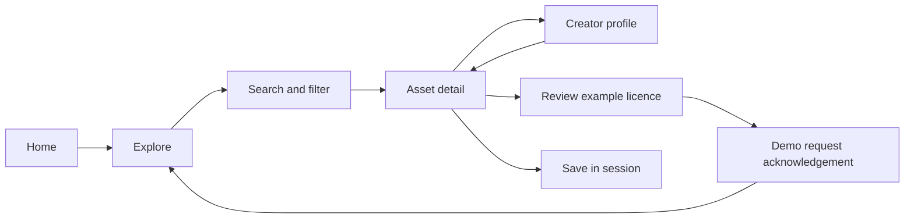
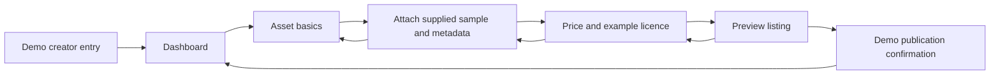

# User flows

## Buyer

The browser search matches titles, creators, categories and asset tags. Category filtering and a price filter combine with the query. No-match states suggest changing the query or resetting filters. Save/unsave uses current-session memory. Example licence content clearly precedes the demo request; no purchase occurs.

## Creator

Title must be non-empty. The sample attachment must be selected before the pricing step. Price must be zero or greater. Back routes preserve entered values within the active browser session. The browser preview uses the edited title and price; the confirmation and catalogue are fixed sample data rather than a real listing database.

## Prototype differences

Figma prepares fixed examples and feedback overlays for typed search, sorting, attachment and saves. The local browser preview is the richer interaction demonstration. Three dedicated mobile buyer artboards adapt home, explore and the courtyard detail. Remaining destinations open desktop reference artboards; they are not completed mobile journeys.
